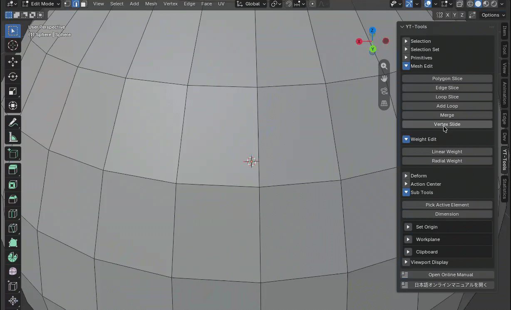

---
# Feel free to add content and custom Front Matter to this file.
# To modify the layout, see https://jekyllrb.com/docs/themes/#overriding-theme-defaults

layout: default
permalink: /yt-tools/release_1_9.html
---
# YT-Tools for Blender v1.9 Release Note

## ✨ New Features Overview

### 🔹 Vertex Slide
<b>Vertex Slide</b> is a tool that moves a vertex's coordinates along the edges connected to it. Clicking a vertex in the 3D view displays arrow handles along the connected edges. Dragging an arrow handle with the Left Mouse Button (LMB) slides the vertex along that edge in the direction of the handle. Holding down the Control key while dragging snaps the movement position along the edge in 10% increments. 

<b>Offset</b> represents the distance the vertex slides along the edge. Enabling <b>Merge</b> causes the sliding vertex to merge with the endpoint vertex if it reaches the end of the edge. Specifying an axis of symmetry via <b>Symmetry</b> causes the vertex at the symmetrical position to move in a corresponding symmetrical direction as you drag the target vertex. 

Enabling <b>Show Normal Handle</b> displays a handle for moving coordinate values ​​along the vertex normal vector. 

<b>Handle Size</b> adjusts the on-screen size of the arrow handle. This value is permanently saved, allowing you to use the same handle size across sessions. 

### 🔹 Edge Flow
EdgeFlow relaxes selected edge loops and nearby parallel flow rails while trying to preserve surface curvature, volume, and the original direction of the mesh flow. 

- Preserves curvature and volume using a rail-based relaxation approach
- Locks the vertex on boundary when <b>Pin Boundary</b> is enabled.
- Supports configurable iteration count, relaxation factor, and tension
- Project relaxing position along the vetex normal when <b>Project Normal</b> is enabled.
- Provides `CENTRIPETAL` and `UNIFORM` Catmull-Rom spline options

